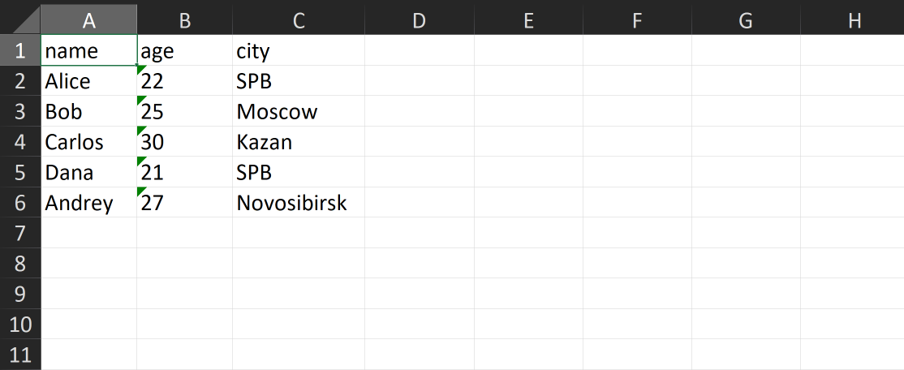
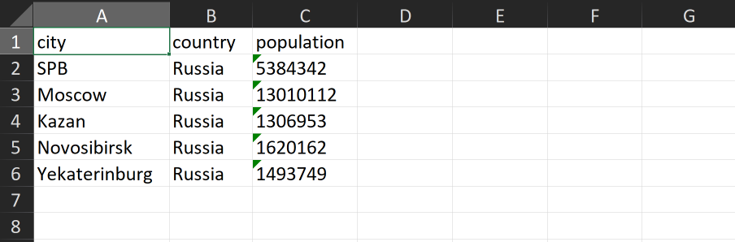

# ЛР5 — JSON и конвертации (JSON↔CSV, CSV→XLSX)

## requirements.txt
```
openpyxl
```
Использована библиотека openpyxl для работы с .xlsx файлами

## Задание A — JSON ↔ CSV
```python
def check_ext(path: str | Path, expected: str) -> Path:
    """Проверяет расширение файла и возвращает Path."""
    result = Path(path)
    if result.suffix.lower() != expected:
        raise ValueError(f"Ожидался файл с расширением {expected}: {result}")
    return result


def json_to_csv(json_path: str, csv_path: str) -> None:
    """
    Преобразует JSON-файл в CSV.
    Поддерживает список словарей [{...}, {...}], заполняет отсутствующие поля пустыми строками.
    Кодировка UTF-8. Порядок колонок — как в первом объекте или алфавитный (указать в README).
    """
    source = check_ext(json_path, ".json")
    target = check_ext(csv_path, ".csv")
    ensure_parent_dir(target)

    with source.open("r", encoding="utf-8") as file:
        try:
            data = json.load(file)
        except json.JSONDecodeError as exc:
            raise ValueError("Пустой JSON или некорректный JSON")

    if type(data) != list or not data:
        raise ValueError("Пустой JSON или неподдерживаемая структура")
    if any(type(item) != dict for item in data):
        raise ValueError("JSON должен содержать список словарей")

    fieldnames = []
    seen = set()
    for item in data:
        for key in item:
            if type(key) != str:
                raise ValueError("Ключи JSON-объектов должны быть строками")
            if key not in seen:
                seen.add(key)
                fieldnames.append(key)

    if not fieldnames:
        raise ValueError("В JSON отсутствуют поля для CSV")

    with target.open("w", newline="", encoding="utf-8") as file:
        writer = csv.DictWriter(file, fieldnames=fieldnames, extrasaction="raise")
        writer.writeheader()
        for item in data:
            writer.writerow({key: item.get(key, "") for key in fieldnames})


def csv_to_json(csv_path: str, json_path: str) -> None:
    """Преобразует CSV в JSON — список словарей со строковыми значениями."""
    source = check_ext(csv_path, ".csv")
    target = check_ext(json_path, ".json")
    ensure_parent_dir(json_path)

    with source.open("r", newline="", encoding="utf-8") as file:
        sample = file.read(1024)
        file.seek(0)

        if not sample.strip():
            raise ValueError("CSV пустой")
        try:
            dialect = csv.Sniffer().sniff(sample, delimiters=",;")
        except csv.Error:
            dialect = csv.excel
        
        reader = csv.DictReader(file, dialect=dialect)
        if not reader.fieldnames:
            raise ValueError("CSV должен содержать заголовок")
        rows = list(reader)

        rows = [{k:row[k] for k in row if row[k] != ""} for row in rows]
            

    with target.open("w", newline="", encoding="utf-8") as file:
        json.dump(rows, file, ensure_ascii=False, indent=2)
```

## Задание B — CSV → XLSX
```python
def csv_to_xlsx(csv_path: str, xlsx_path: str) -> None:
    """Конвертирует CSV в XLSX, задавая ширину столбцов по содержимому."""
    source = Path(csv_path)
    target = Path(xlsx_path)
    ensure_parent_dir(target)

    if source.suffix.lower() != ".csv":
        raise ValueError(f"Ожидался CSV-файл: {source}")
    if target.suffix.lower() != ".xlsx":
        raise ValueError(f"Ожидался XLSX-файл: {target}")

    with source.open("r", newline="", encoding="utf-8") as file:
        sample = file.read(1024)
        file.seek(0)
        if not sample.strip():
            raise ValueError("CSV пустой")
        try:
            dialect = csv.Sniffer().sniff(sample, delimiters=",;")
        except csv.Error:
            dialect = csv.excel
        rows = list(csv.reader(file, dialect=dialect))

    if not rows or not rows[0] or not any(cell.strip() for cell in rows[0]):
        raise ValueError("CSV должен содержать заголовок")

    workbook = Workbook()
    worksheet = workbook.active
    worksheet.title = "Sheet1"

    for row in rows:
        worksheet.append(row)

    for column in worksheet.columns:
        max_length = max((len(str(cell.value)) if cell.value is not None else 0) for cell in column)
        worksheet.column_dimensions[column[0].column_letter].width = max(8, max_length)

    workbook.save(target)
```

## Тесты

### Запуск

json_csv.py
``` python
def main():
    json_to_csv("data/lab05/samples/people.json", "data/lab05/out/people_from_json.csv")
    csv_to_json("data/lab05/samples/people.csv", "data/lab05/out/people_from_csv.json")

if __name__ == "__main__":
    main()
```

csv_xlsx.py
``` python
def main():
    csv_to_xlsx("data/lab05/samples/people.csv", "data/lab05/out/people.xlsx")

if __name__ == "__main__":
    main()
```

### json -> csv

people.json
``` json
[
  {
    "name": "Alice",
    "age": 22,
    "city": "SPB"
  },
  {
    "name": "Bob",
    "age": 25,
    "city": "Moscow"
  },
  {
    "name": "Carlos",
    "age": 30,
    "city": "Kazan"
  },
  {
    "name": "Dana",
    "age": 21,
    "city": "SPB"
  },
  {
    "name": "Andrey",
    "age": 27,
    "city": "Novosibirsk"
  }
]
```

people_from_json.csv
```
name,age,city
Alice,22,SPB
Bob,25,Moscow
Carlos,30,Kazan
Dana,21,SPB
Andrey,27,Novosibirsk
```

teachers.json
``` json
[
  {
    "name": "Alice",
    "age": 35,
    "e-mail": "alice@mail.ru"
  },
  {
    "name": "Bob",
    "age": 36,
    "number": "+791231231231"
  },
  {
    "name": "Jack",
    "age": 42,
    "number": "+7676767676767"
  },
  {
    "name": "Jessica",
    "age": 67,
    "e-mail": "jessica@mail.ru"
  },
  {
    "name": "Elena",
    "age": 25,
    "e-mail": "elena@mail.ru"
  },
  {
    "name": "John",
    "age": 36,
    "number": "+812347712666"
  }
]
```

teachers_from_json.csv
```
name,age,e-mail,number
Alice,35,alice@mail.ru,
Bob,36,,+791231231231
Jack,42,,+7676767676767
Jessica,67,jessica@mail.ru,
Elena,25,elena@mail.ru,
John,36,,+812347712666
```


### csv -> json

people.csv
```
name,age,city
Alice,22,SPB
Bob,25,Moscow
Carlos,30,Kazan
Dana,21,SPB
Andrey,27,Novosibirsk
```

people_from_csv.json
``` json
[
  {
    "name": "Alice",
    "age": "22",
    "city": "SPB"
  },
  {
    "name": "Bob",
    "age": "25",
    "city": "Moscow"
  },
  {
    "name": "Carlos",
    "age": "30",
    "city": "Kazan"
  },
  {
    "name": "Dana",
    "age": "21",
    "city": "SPB"
  },
  {
    "name": "Andrey",
    "age": "27",
    "city": "Novosibirsk"
  }
]
```

teachers.csv
```
name;age;e-mail;number
Alice;35;alice@mail.ru;
Bob;36;;+791231231231
Jack;42;;+7676767676767
Jessica;67;jessica@mail.ru;
Elena;25;elena@mail.ru;
John;36;;+812347712666
```

teachers_from_csv.json
``` json
[
  {
    "name": "Alice",
    "age": "35",
    "e-mail": "alice@mail.ru"
  },
  {
    "name": "Bob",
    "age": "36",
    "number": "+791231231231"
  },
  {
    "name": "Jack",
    "age": "42",
    "number": "+7676767676767"
  },
  {
    "name": "Jessica",
    "age": "67",
    "e-mail": "jessica@mail.ru"
  },
  {
    "name": "Elena",
    "age": "25",
    "e-mail": "elena@mail.ru"
  },
  {
    "name": "John",
    "age": "36",
    "number": "+812347712666"
  }
]
```

### csv -> xlsx

people.csv
```
name,age,city
Alice,22,SPB
Bob,25,Moscow
Carlos,30,Kazan
Dana,21,SPB
Andrey,27,Novosibirsk
```

people.xlsx


cities.csv
```
city,country,population
SPB,Russia,5384342
Moscow,Russia,13010112
Kazan,Russia,1306953
Novosibirsk,Russia,1620162
Yekaterinburg,Russia,1493749
```

cities.xlsx


- Некорректный JSON, пустые файлы, неподдерживаемая структура и неверные расширения вызывают `ValueError`. Отсутствующий входной файл вызывает `FileNotFoundError`.