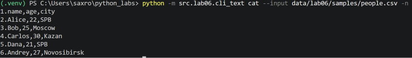
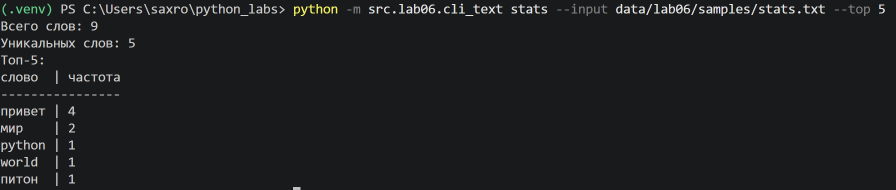
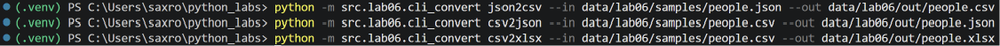
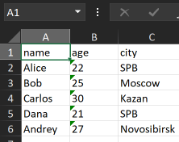
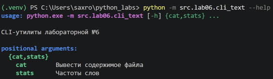
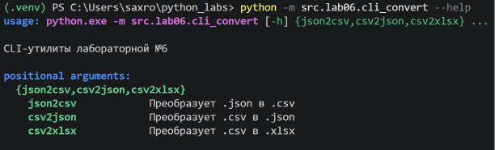

# ЛР6 — CLI‑утилиты с argparse (cat/grep‑lite + конвертеры): Техническое задание

## Функции

```python
def cat(input_path : str, n : bool) -> None:
    p = Path(input_path)
    lines = []

    try:
        with open(p, 'r', encoding='utf-8') as file:
            lines = file.readlines();
    except FileNotFoundError:
        print(f"Ошибка: файл не найден: {p}")
    except UnicodeDecodeError:
        print(f"Ошибка: не удалось прочитать файл {p} в кодировке UTF-8")

    for i in range(len(lines)):
        if n:
            print(f'{i + 1}.{lines[i]}', end='')
        else:
            print(lines[i], end='')

def stats(input_path : str, top : int) -> None:
    p = Path(input_path)

    try:
        with open(p, 'r', encoding='utf-8') as file:
            print_stats(tokenize(normalize(file.read())), n=top)
    except FileNotFoundError:
            print(f"Ошибка: файл не найден: {p}")
    except UnicodeDecodeError:
        print(f"Ошибка: не удалось прочитать файл {p} в кодировке UTF-8")
```

## Парсеры

### cli_text.py

```python
def main() -> None:
    parser = argparse.ArgumentParser(description="CLI‑утилиты лабораторной №6")
    subparsers = parser.add_subparsers(dest="command")

    cat_parser = subparsers.add_parser("cat", help="Вывести содержимое файла")
    cat_parser.add_argument("--input", required=True)
    cat_parser.add_argument("-n", action="store_true", help="Нумеровать строки")

    stats_parser = subparsers.add_parser("stats", help="Частоты слов")
    stats_parser.add_argument("--input", required=True)
    stats_parser.add_argument("--top", type=int, default=5)

    args = parser.parse_args()
    
    if args.command == "cat":
        cat(args.input, args.n)
    elif args.command == "stats":
        if args.top <= 0:
            parser.error("--top должен быть положительным числом")
        stats(args.input, args.top)
```

### cli_convert.py
```python
def main() -> None:
    parser = argparse.ArgumentParser(description="CLI‑утилиты лабораторной №6")
    subparsers = parser.add_subparsers(dest="command")

    j2c_parser = subparsers.add_parser("json2csv", help="Преобразует .json в .csv")
    j2c_parser.add_argument("--in", dest="input", required=True, help="Входной .json файл")
    j2c_parser.add_argument("--out", dest="output", required=True, help="Выходной .csv файл")

    c2j_parser = subparsers.add_parser("csv2json", help="Преобразует .csv в .json")
    c2j_parser.add_argument("--in", dest="input", required=True, help="Входной .csv файл")
    c2j_parser.add_argument("--out", dest="output", required=True, help="Выходной .json файл")

    c2x_parser = subparsers.add_parser("csv2xlsx", help="Преобразует .csv в .xlsx")
    c2x_parser.add_argument("--in", dest="input", required=True, help="Входной .csv файл")
    c2x_parser.add_argument("--out", dest="output", required=True, help="Выходной .xlsx файл")

    args = parser.parse_args()
    
    if args.command == "json2csv":
        json_to_csv(args.input, args.output)
    elif args.command == "csv2json":
        csv_to_json(args.input, args.output)
    elif args.command == "csv2xlsx":
        csv_to_xlsx(args.input, args.output)
```

## Проверка

### cat

people.csv
```
name,age,city
Alice,22,SPB
Bob,25,Moscow
Carlos,30,Kazan
Dana,21,SPB
Andrey,27,Novosibirsk
```



### stats

stats.txt
```
 Привет. привет,, ПрИвЕт мир world
 Python привет, мир.!! питон
```



### Конвертеры


out/people.csv
```
name,age,city
Alice,22,SPB
Bob,25,Moscow
Carlos,30,Kazan
Dana,21,SPB
Andrey,27,Novosibirsk
```

out/people.json
```
[
  {
    "name": "Alice",
    "age": "22",
    "city": "SPB"
  },
  {
    "name": "Bob",
    "age": "25",
    "city": "Moscow"
  },
  {
    "name": "Carlos",
    "age": "30",
    "city": "Kazan"
  },
  {
    "name": "Dana",
    "age": "21",
    "city": "SPB"
  },
  {
    "name": "Andrey",
    "age": "27",
    "city": "Novosibirsk"
  }
]
```

out/people.xlsx



### --help


