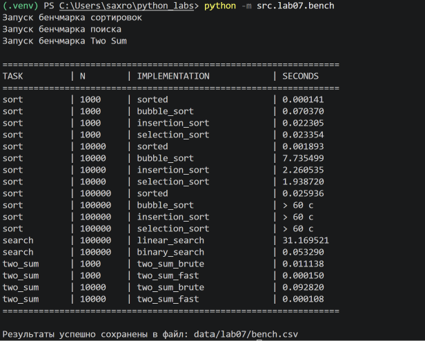
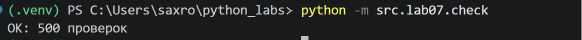

# ЛР7 — Поиск, сортировка и измерение времени

## Результаты бенчмарка

```
task,n,impl,seconds
sort,1000,sorted,0.000141
sort,1000,bubble_sort,0.070370
sort,1000,insertion_sort,0.022305
sort,1000,selection_sort,0.023354
sort,10000,sorted,0.001893
sort,10000,bubble_sort,7.735499
sort,10000,insertion_sort,2.260535
sort,10000,selection_sort,1.938720
sort,100000,sorted,0.025936
sort,100000,bubble_sort,> 60 с
sort,100000,insertion_sort,> 60 с
sort,100000,selection_sort,> 60 с
search,100000,linear_search,31.169521
search,100000,binary_search,0.053290
two_sum,1000,two_sum_brute,0.011138
two_sum,1000,two_sum_fast,0.000150
two_sum,10000,two_sum_brute,0.092820
two_sum,10000,two_sum_fast,0.000108
```



---

## Выводы по работе

### Анализ скорости сортировок и поиска
Замеры четко показывают квадратичную зависимость для пузырька, вставок и выбора. Когда мы увеличиваем размер списка в 10 раз (с 1000 до 10000), время работы пузырьковой сортировки увеличивается сразу в 100 раз — с 0.07 до 7.7 секунд. Это полностью совпадает с теорией O(n²). Встроенный sorted при этом работает по логике n log n и замедляется всего в 12 раз, легко справляясь даже со 100 000 элементов за сотые доли секунды.

С поиском ситуация похожая. Сам по себе бинарный поиск работает мгновенно (0.05 с против 31.16 с у линейного на 10 000 запросах). Но без готовой сортировки он бесполезен, т.к. опирается на то, что элементы до m меньше arr[m], а после - больше. Отсюда вывод: сортировать массив ради одного-двух поисков нет смысла, лучше использовать обычный линейный перебор. Бинарный поиск окупается только тогда, когда база данных сортируется один раз, а запросов к ней много. В задаче Two Sum использование словаря вместо вложенных циклов дало огромный прирост.

## Проверка

Все функции работают корректно

