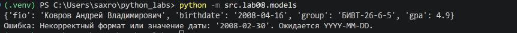
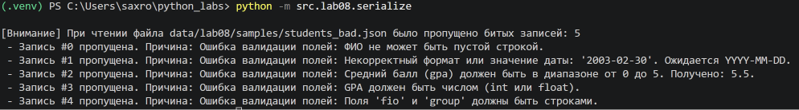

# ЛР8 – Модель данных без классов: запись Student как словарь, валидация и сериализация

## models.py

``` python
from datetime import date

STUDENT_FIELDS = ("fio", "birthdate", "group", "gpa")


def make_student(fio: str, birthdate: str, group: str, gpa: float) -> dict:
    """Собирает запись студента, предварительно проверив каждое поле."""
    if not isinstance(fio, str) or not isinstance(group, str):
        raise ValueError("Поля 'fio' и 'group' должны быть строками.")
    
    fio_clean = fio.strip()
    group_clean = group.strip()

    if not fio_clean:
        raise ValueError("ФИО не может быть пустой строкой.")
    if not group_clean:
        raise ValueError("Группа не может быть пустой строкой.")

    if not isinstance(birthdate, str):
        raise ValueError("Поле 'birthdate' должно быть строкой в формате YYYY-MM-DD.")
    try:
        b_date = date.fromisoformat(birthdate)
    except ValueError:
        raise ValueError(f"Некорректный формат или значение даты: '{birthdate}'. Ожидается YYYY-MM-DD.")
    
    if b_date > date.today():
        raise ValueError(f"Дата рождения не может быть в будущем: '{birthdate}'.")

    if not isinstance(gpa, (int, float)):
        raise ValueError("GPA должен быть числом (int или float).")
    
    gpa_float = float(gpa)
    if not (0.0 <= gpa_float <= 5.0):
        raise ValueError(f"Средний балл (gpa) должен быть в диапазоне от 0 до 5. Получено: {gpa_float}.")

    return {
        "fio": fio_clean,
        "birthdate": birthdate,
        "group": group_clean,
        "gpa": gpa_float
    }


def validate_student(rec: dict) -> None:
    """Проверяет готовый словарь на соответствие структуре и валидность данных."""
    if not isinstance(rec, dict):
        raise ValueError("Запись должна быть словарем.")
    
    if set(rec.keys()) != set(STUDENT_FIELDS):
        raise ValueError(f"Неверный набор ключей. Ожидается: {STUDENT_FIELDS}, получено: {tuple(rec.keys())}.")

    make_student(rec["fio"], rec["birthdate"], rec["group"], rec["gpa"])


def student_age(rec: dict, today: date = None) -> int:
    """Возвращает количество полных лет студента на дату today."""
    validate_student(rec)
    b_date = date.fromisoformat(rec["birthdate"])
    today = today or date.today()
    
    age = today.year - b_date.year
    if (today.month, today.day) < (b_date.month, b_date.day):
        age -= 1
    return age


def format_student(rec: dict) -> str:
    """Возвращает красивую строку с данными студента и инициалами."""
    validate_student(rec)
    
    parts = rec["fio"].split()
    if len(parts) >= 3:
        fio_formatted = f"{parts[0]} {parts[1][0]}.{parts[2][0]}."
    elif len(parts) == 2:
        fio_formatted = f"{parts[0]} {parts[1][0]}."
    else:
        fio_formatted = rec["fio"]

    age = student_age(rec)
    
    if 11 <= age % 100 <= 19:
        age_word = "лет"
    elif age % 10 == 1:
        age_word = "год"
    elif age % 10 in (2, 3, 4):
        age_word = "года"
    else:
        age_word = "лет"

    return f"{fio_formatted} ({rec['group']}), {age} {age_word}, GPA {rec['gpa']:.2f}"


def student_to_dict(rec: dict) -> dict:
    """Возвращает чистую глубокую копию записи для сериализации."""
    validate_student(rec)
    return {
        "fio": rec["fio"],
        "birthdate": rec["birthdate"],
        "group": rec["group"],
        "gpa": rec["gpa"]
    }


def student_from_dict(d: dict) -> dict:
    """Десериализует словарь, извлекая только нужные ключи и валидируя их."""
    if not isinstance(d, dict):
        raise ValueError("Входные данные для десериализации должны быть словарем.")
    
    try:
        rec = make_student(fio=d.get("fio"), birthdate=d.get("birthdate"), group=d.get("group"), gpa=d.get("gpa"))
        validate_student(rec)
        return rec
    except Exception as e:
        raise ValueError(f"Ошибка валидации полей: {e}")


def update_student(rec: dict, **fields) -> dict:
    """Возвращает новую запись с изменёнными полями без мутации старой."""
    validate_student(rec)

    new_data = student_to_dict(rec)
    
    for key, val in fields.items():
        if key not in STUDENT_FIELDS:
            raise KeyError(f"Попытка обновить несуществующее поле '{key}'.")
        new_data[key] = val

    validate_student(new_data)
    return new_data
```

## searialize.py

``` python
import json
import os
from src.lab08.models import student_to_dict, student_from_dict


def students_to_json(students: list[dict], path: str) -> None:
    """Сохраняет список валидных записей студентов в JSON файл."""

    data_to_save = [student_to_dict(s) for s in students]
    
    os.makedirs(os.path.dirname(path), exist_ok=True)
    
    with open(path, "w", encoding="utf-8") as f:
        json.dump(data_to_save, f, ensure_ascii=False, indent=2)


def students_from_json(path: str) -> list[dict]:
    """
    Читает JSON-массив студентов из файла, политика ошибок - skip
    """

    if not os.path.exists(path):
        raise FileNotFoundError(f"Файл не найден по пути: {path}")

    with open(path, "r", encoding="utf-8") as f:
        try:
            raw_data = json.load(f)
        except json.JSONDecodeError as e:
            raise ValueError(f"Некорректный формат JSON файла: {e}")

    if not isinstance(raw_data, list):
        raise ValueError("JSON корень должен быть массивом (list).")

    valid_students = []
    skipped_count = 0
    skip_reasons = []

    for index, item in enumerate(raw_data):
        try:
            student = student_from_dict(item)
            valid_students.append(student)
        except Exception as e:
            skipped_count += 1
            skip_reasons.append(f"Запись #{index} пропущена. Причина: {e}")

    if skipped_count > 0:
        print(f"\n[Внимание] При чтении файла {path} было пропущено битых записей: {skipped_count}")
        for reason in skip_reasons:
            print(f" - {reason}")
            
    return valid_students
```

## Политика обработки битых записей
В модуле сериализации внедрена политика **`skip` (пропуск некорректных записей)**. 

При обнаружении поврежденного или невалидного объекта в файле (например, ошибочный GPA или некорректная дата), программа не прекращает аварийно свою работу целиком. Вместо этого сбойная запись отбрасывается, инцидент логируется в консоль с указанием порядкового номера элемента и детальной причины ошибки. В конце обработки выводится суммарный отчет по пропущенным элементам. 
Это позволяет успешно выгрузить максимальное количество корректных данных из частично поврежденного источника.

## Проверка

### models.py

``` python
def main():
    student = make_student("Ковров Андрей Владимирович", "2008-04-16", "БИВТ-26-6-5", 4.9)
    print(student)

    try:
        student = make_student("Далевич Владислав", "2008-02-30", "БИВТ-26-6-4", 4.9)
    except ValueError as e:
        print(f"Ошибка: {e}")
```



### serialize.py

``` python
def main():
    input_path = "data/lab08/samples/students_input.json"
    bad_path = "data/lab08/samples/students_bad.json"
    out_path = "data/lab08/out/students_out.json"

    loaded = students_from_json(input_path)
    loaded.append(make_student("Ковров Андрей Владимирович", "2008-04-16", "БИВТ-26-6-5", 4.9))
    students_to_json(loaded, out_path)

    students_from_json(bad_path)
```

students_input.json
``` json
[
  {
    "fio": "Кузнецов Алексей Владимирович",
    "birthdate": "2006-03-15",
    "group": "БИВТ-26-6-1",
    "gpa": 4.5
  },
  {
    "fio": "Маркова Диана Игоревна",
    "birthdate": "2007-09-20",
    "group": "БИВТ-26-6-2",
    "gpa": 5
  },
  {
    "fio": "Петров Петр Петрович",
    "birthdate": "2005-12-31",
    "group": "ИВЧ-25-1",
    "gpa": 3.82
  }
]
```

students_bad.json
``` json
[
  {
    "fio": "  ",
    "birthdate": "2006-03-15",
    "group": "БИВТ-26-6-1",
    "gpa": 4.5
  },
  {
    "fio": "Иванов Иван Иванович",
    "birthdate": "2003-02-30",
    "group": "БИВТ-26-6-1",
    "gpa": 4.0
  },
  {
    "fio": "Смирнова Анна Сергеевна",
    "birthdate": "2007-04-12",
    "group": "БИВТ-26-6-1",
    "gpa": 5.5
  },
  {
    "fio": "Козлов Игорь Дмитриевич",
    "birthdate": "2006-05-23",
    "group": "БИВТ-26-6-1",
    "gpa": "отлично"
  },
  {
    "fio": "Федоров Артем Викторович",
    "birthdate": "2005-08-14",
    "gpa": 4.2
  },
  {
    "fio": "Павлова Елена Юрьевна",
    "birthdate": "2006-11-02",
    "group": "БИВТ-26-6-1",
    "gpa": 4.1,
    "extra_field": "unknown"
  },
  {
    "fio": "Петров Петр Петрович",
    "birthdate": "2005-12-31",
    "group": "ИВЧ-25-1",
    "gpa": 3.82
  }
]
```



students_out.json
``` json
[
  {
    "fio": "Кузнецов Алексей Владимирович",
    "birthdate": "2006-03-15",
    "group": "БИВТ-26-6-1",
    "gpa": 4.5
  },
  {
    "fio": "Маркова Диана Игоревна",
    "birthdate": "2007-09-20",
    "group": "БИВТ-26-6-2",
    "gpa": 5.0
  },
  {
    "fio": "Петров Петр Петрович",
    "birthdate": "2005-12-31",
    "group": "ИВЧ-25-1",
    "gpa": 3.82
  },
  {
    "fio": "Ковров Андрей Владимирович",
    "birthdate": "2008-04-16",
    "group": "БИВТ-26-6-5",
    "gpa": 4.9
  }
]
```