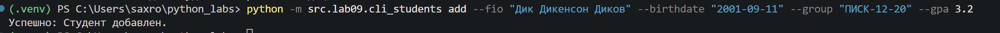
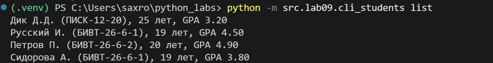
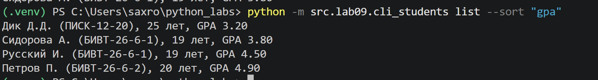
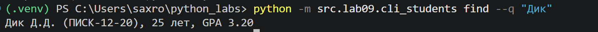
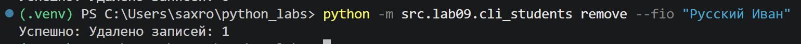
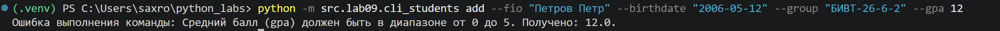

# ЛР9 — «База данных» на CSV: CRUD-функции над students.csv и CLI

## group.py
``` python
import csv
import collections
from pathlib import Path
from src.lab08.models import STUDENT_FIELDS, student_from_dict, validate_student
from src.lab08.models import update_student as mdls_update

HEADER = STUDENT_FIELDS


def ensure_storage(path):
    """Если файла нет, создает его с одной строкой-заголовком. Создает каталоги."""
    path = Path(path)
    if not path.exists():
        path.parent.mkdir(parents=True, exist_ok=True)
        with open(path, mode="w", encoding="utf-8", newline="") as f:
            writer = csv.writer(f)
            writer.writerow(HEADER)


def load_students(path) -> list[dict]:
    """Читает все записи из CSV. Отсутствие заголовка или лишние колонки - ValueError."""
    ensure_storage(path)
    students = []
    
    with open(path, mode="r", encoding="utf-8", newline="") as f:
        reader = csv.DictReader(f)
        
        if reader.fieldnames is None or set(reader.fieldnames) != set(HEADER):
            raise ValueError("Некорректная структура заголовков CSV-файла.")
            
        for row in reader:
            try:
                student = student_from_dict(row)
                validate_student(student)
                students.append(student)
            except (KeyError, ValueError, TypeError) as e:
                raise ValueError(f"Ошибка валидации данных в строке CSV: {e}")
                
    return students


def save_students(path, students):
    """Перезаписывает файл целиком корректными данными."""
    path = Path(path)
    path.parent.mkdir(parents=True, exist_ok=True)
    
    with open(path, mode="w", encoding="utf-8", newline="") as f:
        writer = csv.DictWriter(f, fieldnames=HEADER)
        writer.writeheader()
        for student in students:
            writer.writerow(student)


def add_student(path, student: dict):
    """Валидирует запись и дописывает в конец. Запрет дубликатов"""
    
    validate_student(student)
        
    students = load_students(path)
    
    if any(s["fio"].lower() == student["fio"].lower() for s in students):
        raise ValueError(f"Студент с ФИО '{student['fio']}' уже существует в базе данных.")
        
    students.append(student)
    save_students(path, students)


def list_students(path, sort_by=None) -> list[dict]:
    students = load_students(path)
    if sort_by is None:
        return students
        
    if sort_by not in ("fio", "gpa"):
        raise ValueError("Недопустимый параметр сортировки. Используйте 'fio' или 'gpa'.")
        
    return sorted(students, key=lambda x: x[sort_by])


def find_students(path, substr: str) -> list[dict]:
    """Поиск по подстроке в ФИО без учета регистра."""
    students = load_students(path)
    substr_lower = substr.lower()
    return [s for s in students if substr_lower in s["fio"].lower()]


def remove_student(path, fio: str) -> int:
    """Удаляет ВСЕ записи с таким fio, возвращает количество удаленных."""
    students = load_students(path)
    initial_count = len(students)
    
    students = [s for s in students if s["fio"].lower() != fio.lower()]
    
    removed_count = initial_count - len(students)
    if removed_count > 0:
        save_students(path, students)
        
    return removed_count


def update_student(path, fio: str, **fields) -> bool:
    """Обновляет поля ПЕРВОЙ записи с таким fio. Результат валидируется."""
    students = load_students(path)
    
    for key in fields:
        if key not in HEADER:
            raise KeyError(f"Неизвестное поле для обновления: {key}")
            
    for i, student in enumerate(students):
        if student["fio"].lower() == fio.lower():
            updated = mdls_update(student, fields=fields)
            students[i] = updated
            save_students(path, students)
            return True
            
    return False


def stats(path) -> dict:
    """Собирает расширенную аналитику по студентам."""
    students = load_students(path)
    if not students:
        return { "count": 0, "min_gpa": 0.0, "max_gpa": 0.0, "avg_gpa": 0.0, "groups": {}, "top_5_students": [] }
        
    gpas = [s["gpa"] for s in students]
    groups_counts = collections.Counter([s["group"] for s in students])
    
    sorted_by_gpa = sorted(students, key=lambda x: x["gpa"], reverse=True)
    top_5 = [{"fio": s["fio"], "gpa": s["gpa"]} for s in sorted_by_gpa[:5]]
    
    return {
        "count": len(students),
        "min_gpa": min(gpas),
        "max_gpa": max(gpas),
        "avg_gpa": round(sum(gpas) / len(students), 2),
        "groups": dict(groups_counts),
        "top_5_students": top_5
    }
```

## cli_students.py
``` python
import sys
import argparse
from src.lab08.models import format_student
from src.lab09.group import add_student, list_students, find_students, remove_student, update_student, stats

def main():
    path = "data/lab09/students.csv"

    parser = argparse.ArgumentParser(description="CLI утилита для управления базой данных студентов на CSV.")
    
    subparsers = parser.add_subparsers(dest="command", required=True, help="Доступные команды")
    
    parser_add = subparsers.add_parser("add", help="Добавить нового студента")
    parser_add.add_argument("--fio", required=True, help="ФИО студента")
    parser_add.add_argument("--birthdate", required=True, help="Дата рождения (ГГГГ-ММ-ДД)")
    parser_add.add_argument("--group", required=True, help="Учебная группа")
    parser_add.add_argument("--gpa", required=True, type=float, help="Средний балл (GPA)")
    
    parser_list = subparsers.add_parser("list", help="Вывести список студентов")
    parser_list.add_argument("--sort", choices=["fio", "gpa"], help="Сортировка по полю")
    
    parser_find = subparsers.add_parser("find", help="Поиск студента по ФИО")
    parser_find.add_argument("--q", required=True, help="Подстрока для поиска в ФИО")
    
    parser_remove = subparsers.add_parser("remove", help="Удалить студента по ФИО")
    parser_remove.add_argument("--fio", required=True, help="Точное ФИО студента для удаления")
    
    parser_update = subparsers.add_parser("update", help="Обновить данные существующего студента")
    parser_update.add_argument("--fio", required=True, help="ФИО студента, которого нужно обновить")
    parser_update.add_argument("--birthdate", help="Новая дата рождения")
    parser_update.add_argument("--group", help="Новая учебная группа")
    parser_update.add_argument("--gpa", type=float, help="Новый средний балл (GPA)")
    
    subparsers.add_parser("stats", help="Показать расширенную аналитику и статистику по базе данных")

    args = parser.parse_args()

    try:
        if args.command == "add":
            new_student = {
                "fio": args.fio,
                "birthdate": args.birthdate,
                "group": args.group,
                "gpa": args.gpa
            }
            add_student(path, new_student)
            print("Успешно: Студент добавлен.")
            
        elif args.command == "list":
            students = list_students(path, sort_by=args.sort)
            if not students:
                print("База данных пуста.")
            for s in students:
                print(format_student(s))
                
        elif args.command == "find":
            students = find_students(path, args.q)
            if not students:
                print("Студенты не найдены.")
            for s in students:
                print(format_student(s))
                
        elif args.command == "remove":
            deleted = remove_student(path, args.fio)
            print(f"Успешно: Удалено записей: {deleted}")
            
        elif args.command == "update":
            update_fields = {}
            if args.birthdate is not None:
                update_fields["birthdate"] = args.birthdate
            if args.group is not None:
                update_fields["group"] = args.group
            if args.gpa is not None:
                update_fields["gpa"] = args.gpa
                
            if not update_fields:
                raise ValueError("Предупреждение: Не переданы поля для обновления.")
                
            found = update_student(path, args.fio, **update_fields)
            if found:
                print("Успешно: Данные студента обновлены.")
            else:
                raise ValueError(f"Ошибка: Студент с ФИО '{args.fio}' не найден.")
                
        elif args.command == "stats":
            data = stats(path)
            print(f"Общее количество студентов: {data['count']}")
            print(f"GPA (Мин / Макс / Средний): {data['min_gpa']} / {data['max_gpa']} / {data['avg_gpa']}")
            print("Распределение по группам:")
            for grp, cnt in data['groups'].items():
                print(f"  - {grp}: {cnt} чел.")
            print("Топ-5 студентов по успеваемости:")
            for i, s in enumerate(data['top_5_students'], 1):
                print(f"  {i}. {s['fio']} — GPA: {s['gpa']}")

    except (ValueError, KeyError, TypeError) as err:
        print(f"Ошибка выполнения команды: {err}", file=sys.stderr)


if __name__ == "__main__":
    main()
```

## Команды


---

---

---

---

---

---

## Итоговый csv
```
fio,birthdate,group,gpa
Дик Дикенсон Диков,2001-09-11,ПИСК-12-20,3.2
Петров Петр,2006-05-12,БИВТ-26-6-2,4.9
Сидорова Анна,2007-01-22,БИВТ-26-6-1,3.8
```